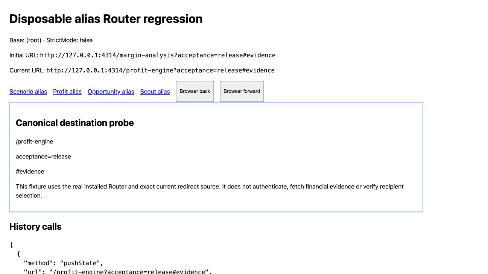
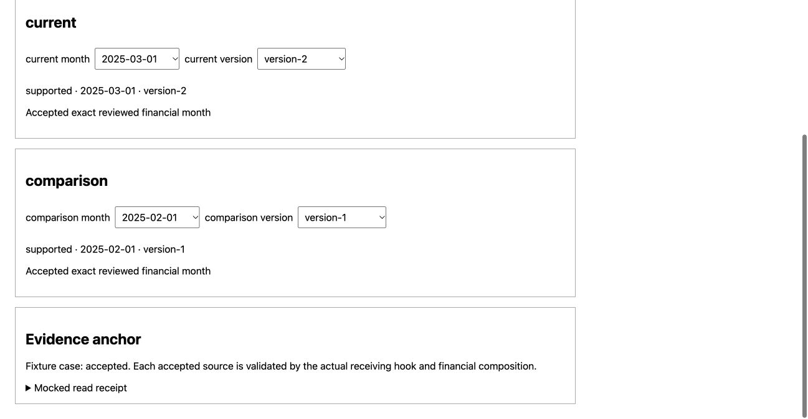

# Exact legacy-alias query regression — 21 November 2026

Separate source fix atop405c3eb, not a deployment. Scout5dd, remount-safe selectors and accepted layouts remain frozen. Data remains sole deployment/hosted-acceptance owner.

## Coordinated failing receipt and diagnosis
The exact data receipt is preserved from published **21e5112b1635e60e239c2186febb4bef8a9591f4**, docs/hosted-release-receipt-2026-11-21.md. Its live3eda388 probe was:

`/margin-analysis?acceptance=release#evidence` → `/profit-engine#evidence`

Expected `/profit-engine?acceptance=release#evidence`. Scout direct reporting links passed live. The source diagnosis is the explicit query allowlist: `acceptance` was an unrecognised key and deliberately filtered. Installed Wouter forwards the complete supplied URL; no evidence supports blaming Router for stripping it. Existing reviewed-source query keys were already retained.

## Bounded fix
Add only inert `acceptance` metadata to LEGACY_CONTEXT_KEYS. The same duplicate, empty and control-character rejection applies. This value is never parsed as reporting evidence, membership, scenario assumptions or authority. Unknown parameters, obsolete spend/CAC/order assumptions and external next destinations remain excluded. Fixed destination Plan tab/legacy values still win; source query/hash preserve their existing policy. No generic unknown-query passthrough, App route/history refactor, replacement-navigation change or selector edit.

All three existing Profit aliases use the shared helper: /margin-analysis, /new-profit, /pricing-optimisation. Other existing aliases benefit only from the same inert metadata handling. Original/reference pages remain routed as before. #evidence is the literal recorded probe fragment; preserving it is not a claim that it is the connected Profit evidence section. Actual connected Profit evidence uses #np-linked-evidence; no anchor is created or renamed by this patch.

## Focused verification
**13/13 route/navigation unit tests pass**, including3new regression cases: exact recorded probe/all3Profit alias bindings; acceptance alongside current/prior financial scope while blocked assumptions stay excluded; duplicate/empty/control rejection. Existing fixed-tab/hash assertions are strengthened with acceptance+conflicting tab/legacy/spend. Pure helper output tests are distinguished from browser routing below.

Full root production build passes on this source, including referenced libraries,4workspace typechecks, API and both frontend bundles. Existing nonfatal sourcemap/mixed-import/chunk-size warnings remain. No unchanged Plan/Cash18, support4 or core46test suites were repeatedly rerun; their source is preserved and prior receipts remain scoped to their tested revisions.

Isolated loopback browser matrix, using actual installed React/Wouter and exact current ContextRedirect/helper:
- Recorded /margin-analysis probe → exact expected canonical query+fragment.
- /new-profit and /pricing-optimisation → same canonical metadata+fragment.
- Scenario alias retains tab=planner&legacy=1 and acceptance/hash, rejects incoming conflicting tab/legacy and spend.
- /preview base-path +StrictMode retains query/fragment; SPA Profit alias retains full current/prior context.
- Existing push-history behaviour is unchanged; no Back-stack remediation is claimed.

Independent member-bound fixture used the actual unchanged receiving hook, TanStack query and financial validation/composition with synthetic auth and mocked same-origin read-only source responses. Alias→canonical retained acceptance/current/prior/hash and accepted exact March2025/version2 and February2025/version1. Explicit clearing stayed cleared; changing business and returning did not replay old scope. Wrong company, revoked current version, unadvertised version and mocked403 denial produced no selected/accepted substitute figures. No sample fallback. This is isolated source acceptance, not live authenticated member/nonmember/provider acceptance or full real Profit-page rendering. The product membership/server guards are unchanged.

Local fixture scripts remain outside source under review/; they make no provider/database requests. Hosted tab was not used. Member-bound evidence is fixture-only, not a new financial-data receipt.

## Follow-on release boundary
This branch retains405c3eb's separate support+Plan/Cash source package and additionally preserves the published live receipt21e5112 as a documentation-only merge. The corrected published source SHA/tree is supplied in the completion checkpoint; an exact pinned replacement approval document follows. **Do not deploy405c3eb unchanged** or reuse3eda388's previous approval. Current live3eda388 is preserved as an ancestor and prospective rollback baseline subject to immediate live-head reconciliation.

No provider operation, DB/schema/data/grant, sidecar activation, feed/job, configuration/settings, credential, service sizing, production/main merge, deployment or spending. The unchanged source receives a narrowly expanded inert metadata allowlist only. Real hosted rerun of the recorded alias and exact reviewed scopes remains data's post-release acceptance task after new exact approval.
