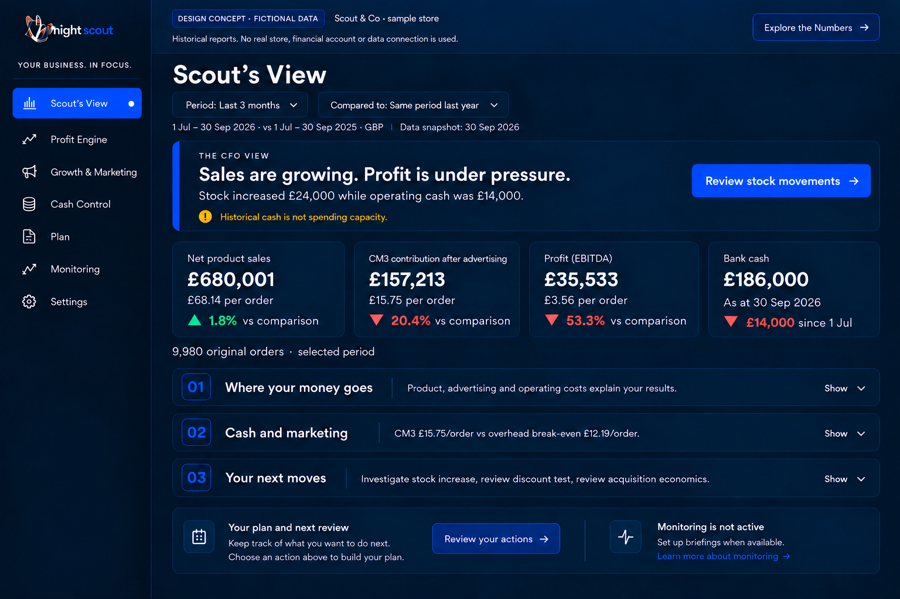
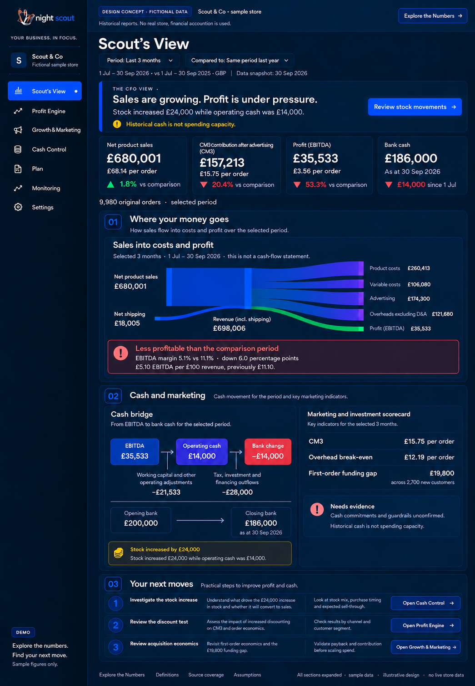
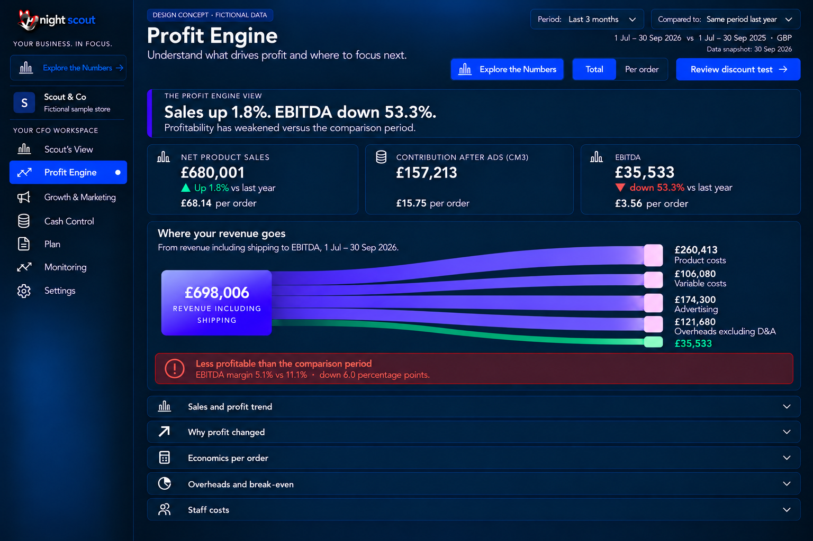
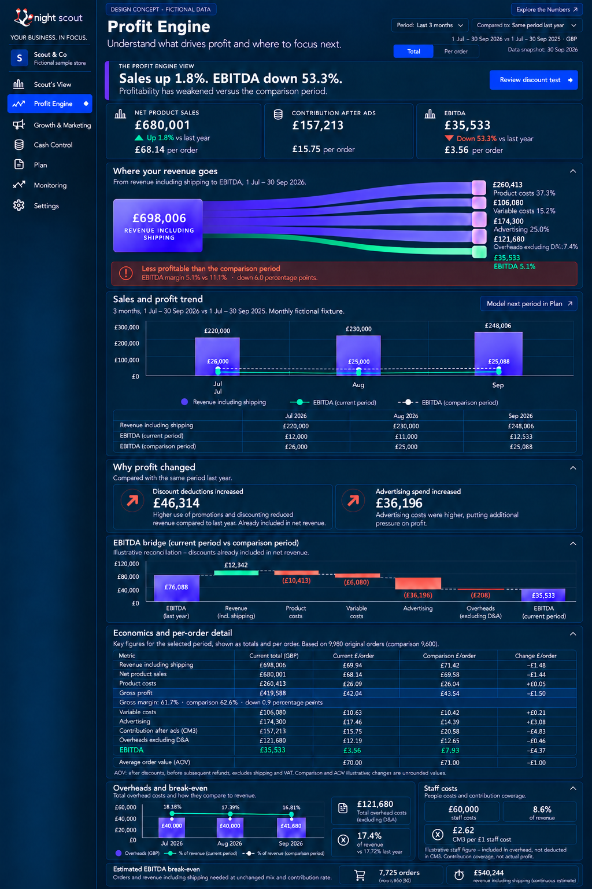
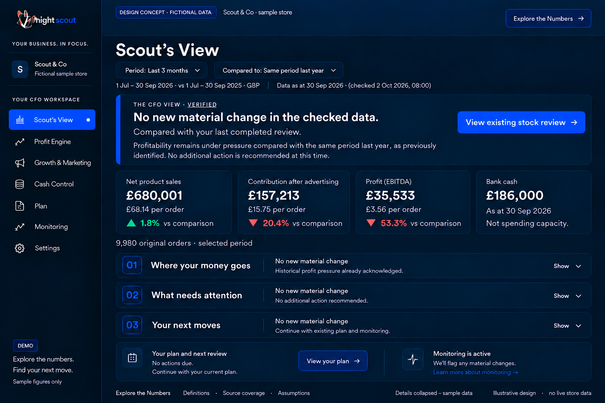
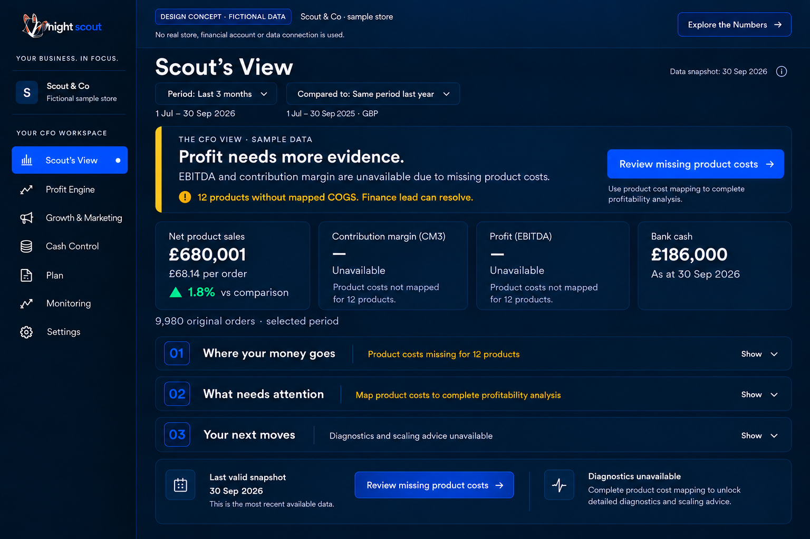

# 7 Scout View and Profit Engine

## Scout View

SV01 P1. Default and expanded versions share the same verdict: Sales are growing. Profit is under pressure. The supporting finding is stock increased £24,000 while operating cash was £14,000. Review stock movements is the primary action. The four cards show net sales £680,001 / £68.14 per order, CM3 £157,213 / £15.75, EBITDA £35,533 / £3.56 and bank £186,000 as at 30 September. Cash has no per-order ratio.

SV02 P0/P1. Where your money goes, Cash and marketing, and Your next moves start closed. Expansion reveals the reconciled Sankey and profitability commentary, compact EBITDA → operating cash → bank movement sequence, and investment summary. The latter compares CM3 £15.75 with overhead coverage £12.19 per order and shows the £19,800 acquisition gap. Cash commitments and guardrails remain unconfirmed; no Scale or spending-capacity claim follows.

SV03 P1. Next moves link to stock evidence, discount-test assumptions and acquisition economics. The selected primary issue must come from supported ranking, not a hardcoded permanent stock warning. Quiet and incomplete variants use the state contract in section 4. Remove the obsolete last-week example, buffer and pending-marketing copy.

## Profit Engine

PR01 P0/P1. Lead with Sales up 1.8%. EBITDA down 53.3%, Review discount test and Explore the Numbers. Keep the Total / Per order toggle and the three agreed cards. The default keeps the Sankey and its profitability callout; trend, bridge, economics, overheads and staff sections start closed. No decorative sparklines.

PR02 P1. Revenue including shipping is bars; current EBITDA is a solid line and the selected comparison EBITDA a dotted line. Keep future extrapolation in Plan with explicit assumptions, not on the historical chart. Below the profit-change callouts place the EBITDA waterfall; the callouts must not create duplicated bridge adjustments.

PR03 P0/P1. Economics detail includes total, current per order, selected-comparison per order and change calculated before rounding. Explicit rows include AOV, gross profit and gross margin. Gross profit excludes shipping; EBITDA margin includes net shipping in its revenue denominator. Fixed-cost detail shows total overheads, percentage of revenue, the selected-comparison ratio, break-even orders/revenue and staff coverage.

PR04 P1. Beneath the Sankey, commentary uses more profitable, broadly unchanged or less profitable with current margin, comparison margin and percentage-point change. Colour follows an agreed versioned materiality tolerance; it is neutral if evidence is inadequate. A falling margin is not improvement because sales rose.

## Acceptance

P0: both periods, Sankey, waterfall and per-order table reconcile; scope and context survive every selector. P1: default and expanded headers match; one primary task is obvious; all chart values are accessible. Preserve the Sankey while meeting the ten-second owner test. No discount scenario silently assumes unchanged demand.

[Back to the design index](README.md)

## Related mockups

These are illustrative designs with fictional data, not live screenshots.

### Scout View default

### Scout View expanded

### Profit Engine default

### Profit Engine expanded

### Scout View verified quiet state

### Scout View incomplete evidence state

