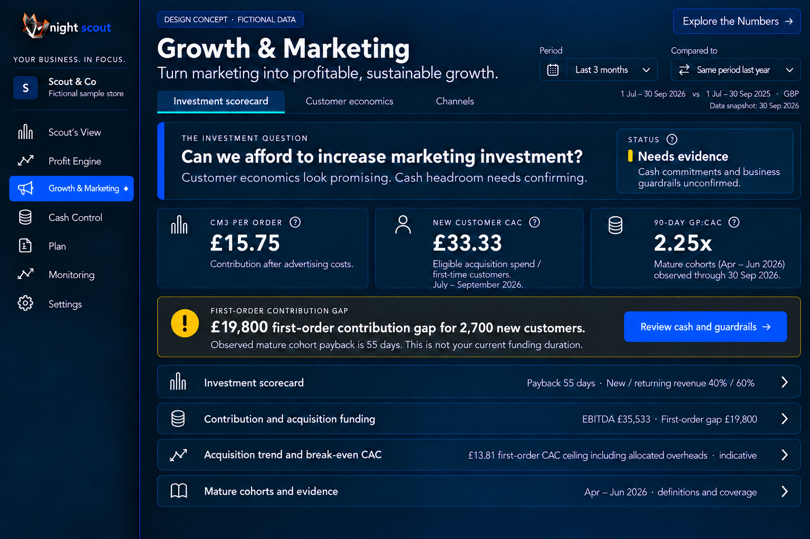
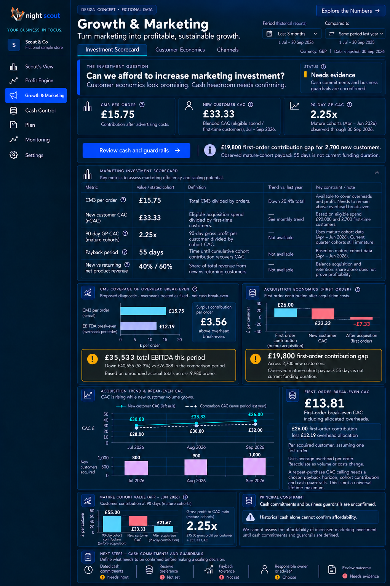
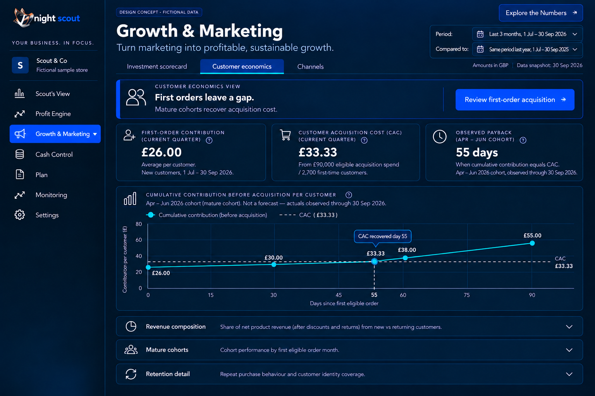
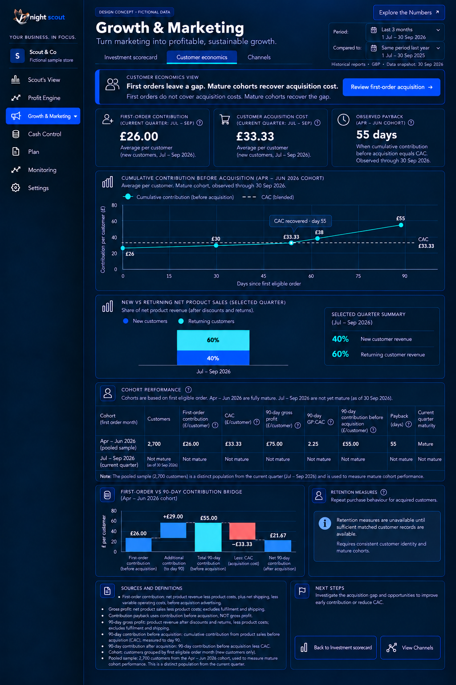
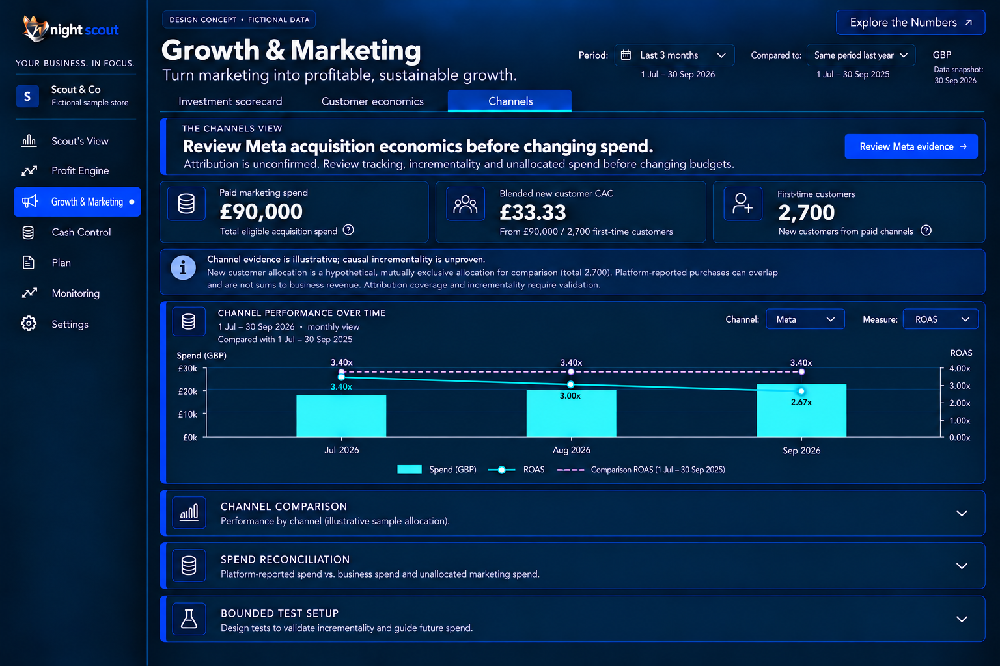
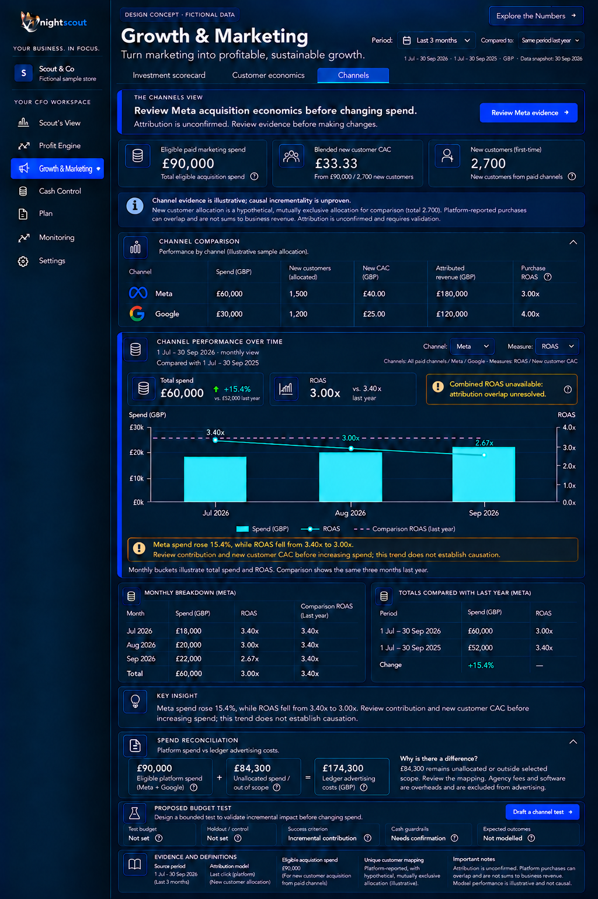

# 8 Growth and Marketing page specifications

## Investment Scorecard

GM01 P1. Default entry asks Can we afford to increase marketing investment? The example status is Needs evidence because commitments and business guardrails are unconfirmed. Three cards show CM3/order £15.75, current-quarter CAC £33.33 and mature April–June GP:CAC 2.25. Review cash and guardrails is the primary action.

GM02 P0/P1. Four closed diagnostic groups reveal the five metrics, overhead coverage and acquisition gap, CAC/customer trend, and mature-cohort evidence. The expanded view shows £35,533 EBITDA versus £76,088 and the £19,800 gap. Put the full first-order break-even CAC label beside £13.81. Always distinguish current acquisition from observed mature-cohort payback.

GM03 P1. The primary action opens a short checklist: dated commitments, reserve preference, payback tolerance, responsible owner/adviser and review outcome. Historical cash alone cannot confirm future affordability. With unresolved inputs show Needs evidence; do not substitute Hold or expose misleading disabled verdict choices as a dashboard.

## Customer Economics

GM04 P1. Both states lead with First orders leave a gap. Mature cohorts recover acquisition cost, and Review first-order acquisition. The three cards show current first-order contribution £26, current CAC £33.33 and mature observed payback 55 days, with their separate cohort labels. The default’s one useful visual is the mature payback curve. Composition, cohorts and retention detail begin closed.

GM05 P0. Expanded detail shows the 40%/60% quarter split, mature cohort table and contribution bridge, and explicit immature/unavailable values. Separate gross profit from contribution. Do not assert a retention intervention without matched records; unsupported retention measures remain unavailable. The curve crosses the matched cohort’s CAC at the observed day, not a forecasted date.

## Channels

GM06 P1. Lead with Review Meta acquisition economics before changing spend and Review Meta evidence. Keep one spend/metric trend. Channel comparison, spend reconciliation and bounded-test setup begin closed; the expanded view reveals them. Remove the duplicate donut and competing takeaway panels.

GM07 P0/P1. Channel selector supports All paid channels, Meta and Google; metric selector supports ROAS or new-customer CAC when scoped evidence exists. Spend uses bars, current metric a solid line, selected comparison a dotted line. The chart follows the selected report range and labelled aggregation. Tooltips/value tables include dates, numerator, denominator and currency. None removes comparison.

GM08 P0. Platform attribution is not incrementality. No automatic reallocation follows lower CAC or higher ROAS. Channel-matched first-order contribution is unavailable in this fixture; do not present store-wide £26 as a channel benchmark. Reconcile spend using section 6B and retain unresolved scope honestly.

## Acceptance

Changing period, channel or metric refreshes all affected content together. Ratios are calculated from summed matched amounts. Mature measures require sufficient observation and identity coverage. A scaling recommendation requires supported contribution, business guardrails and cash capacity, plus a bounded amount, horizon and review/stop rules. A missing input cannot produce healthy advice.

[Back to the design index](README.md)

## Related mockups

These are illustrative designs with fictional data, not live screenshots.

### Investment Scorecard default

### Investment Scorecard expanded

### Customer Economics default

### Customer Economics expanded

### Channels default

### Channels expanded

