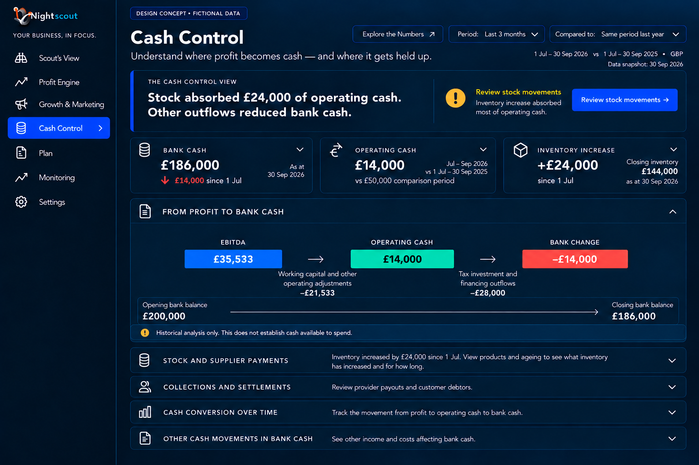
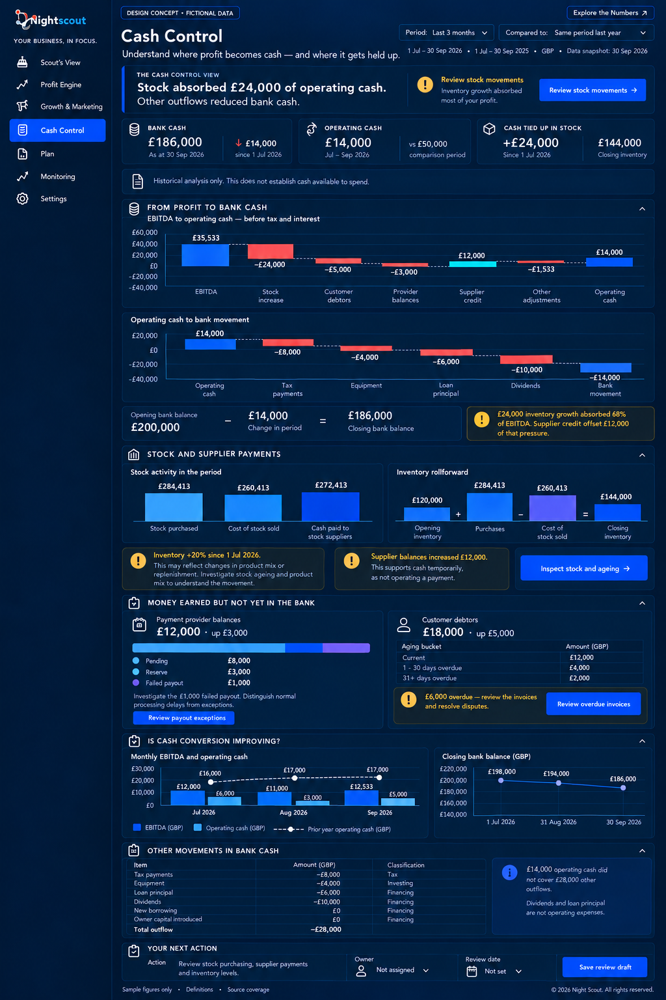

# 8A Cash Control

CC01 P1. Default and expanded states lead with Stock absorbed £24,000 of operating cash. Other outflows reduced bank cash. The primary action is Review stock movements. Cards show dated bank cash £186,000, operating cash £14,000 versus £50,000, and stock increase £24,000 since 1 July. The default retains a compact profit-to-bank sequence; further detail is collapsed.

CC02 P0. Expansion shows the two reconciled waterfalls in section 6A. Distinguish EBITDA, operating cash before tax/interest, bank movement and bank balance. Exclude internal transfers, duplicate payouts and unsupported adjustments. A source report’s date is not a live bank-feed timestamp. Require explicit bank/account coverage.

CC03 P1. Stock and supplier payments separates stock purchased, cost of goods sold, supplier cash paid, credit movements and inventory balances. Inspect stock and ageing opens affected product records, age, sell-through, lead times and replenishment context. Do not label a stock increase excessive without that evidence. Do not compare since-period-start stock growth with year-on-year sales growth as if they were matched.

CC04 P0/P1. Collections and settlements separates pending provider money, reserves, failed payouts and credit debtors. Review failed payout opens the provider record; review overdue invoices opens invoice/dispute evidence. Match capture-to-bank timing from actual transactions when available. Do not add receivables or reserves to unrestricted cash.

CC05 P1. Plot monthly EBITDA and operating cash with selected-comparison operating cash dotted. Keep closing bank balances in a separate aligned chart because a balance is not a period flow. Other movements lists tax, equipment, principal, dividends/drawings and other supported financing/investment items. No future extension is shown.

CC06 P1. An owner may prepare a review draft with owner and date once persistence exists. A saved review is not a payment, cancelled purchase, reminder or measured saving. Where unsupported, offer a read-only investigation and explain that saving is unavailable.

## Acceptance and forecast boundary

P0: opening bank plus flows equals closing bank; inventory and supplier movements reconcile; overdue categories do not overlap; unknown values remain unknown. P1: default bank date matches expanded, primary stock action opens relevant evidence, immaterial debtor detail stays quiet only after verification. No historical figure is labelled safe to spend or instantly recoverable.

A future 13-week forecast requires dated opening balances, invoices/payment schedules, purchase commitments, provider settlements, tax/debt due dates and transfer exclusions. Distinguish actual, committed and estimated amounts; every week must roll forward. Historical cover is not a predicted shortage date. Forecasting is separate from this final historical design.

[Back to the design index](README.md)

## Related mockups

These are illustrative designs with fictional data, not live screenshots.

### Cash Control default

### Cash Control expanded

