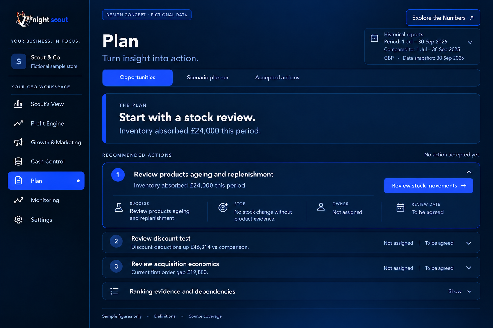
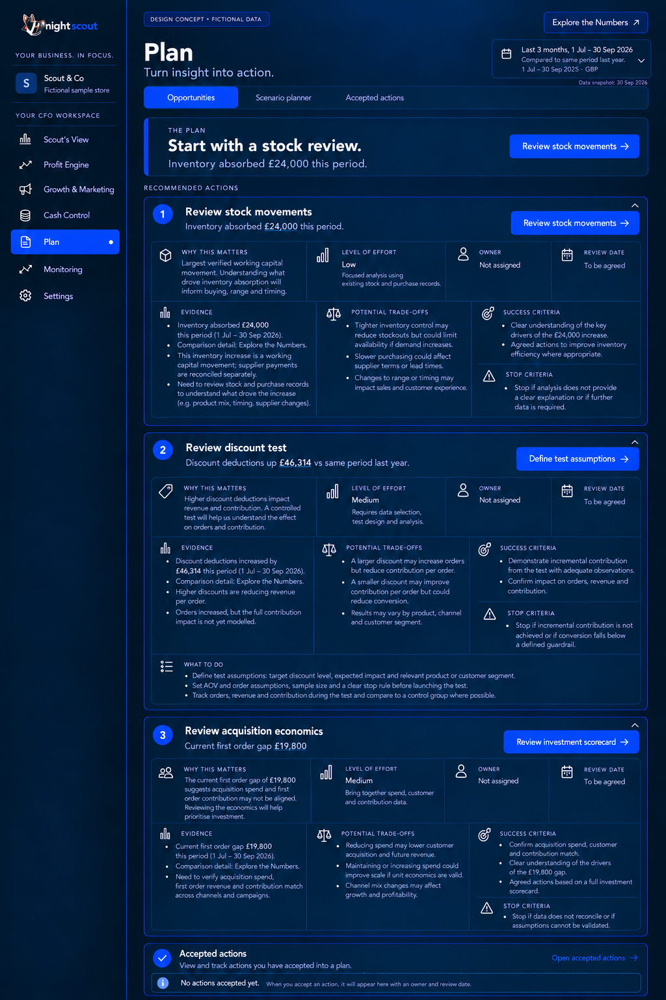
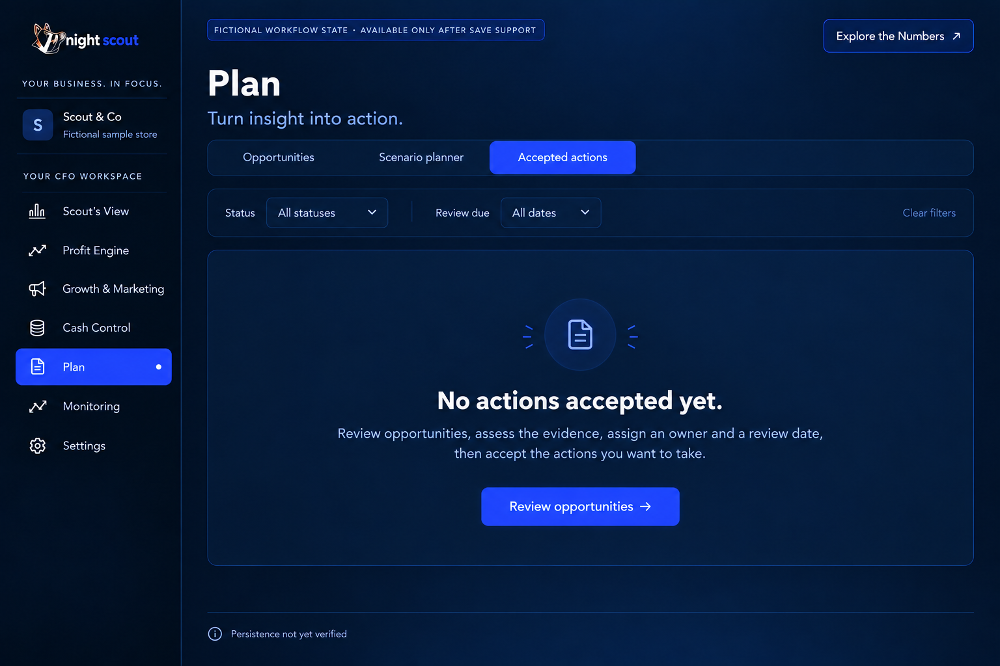
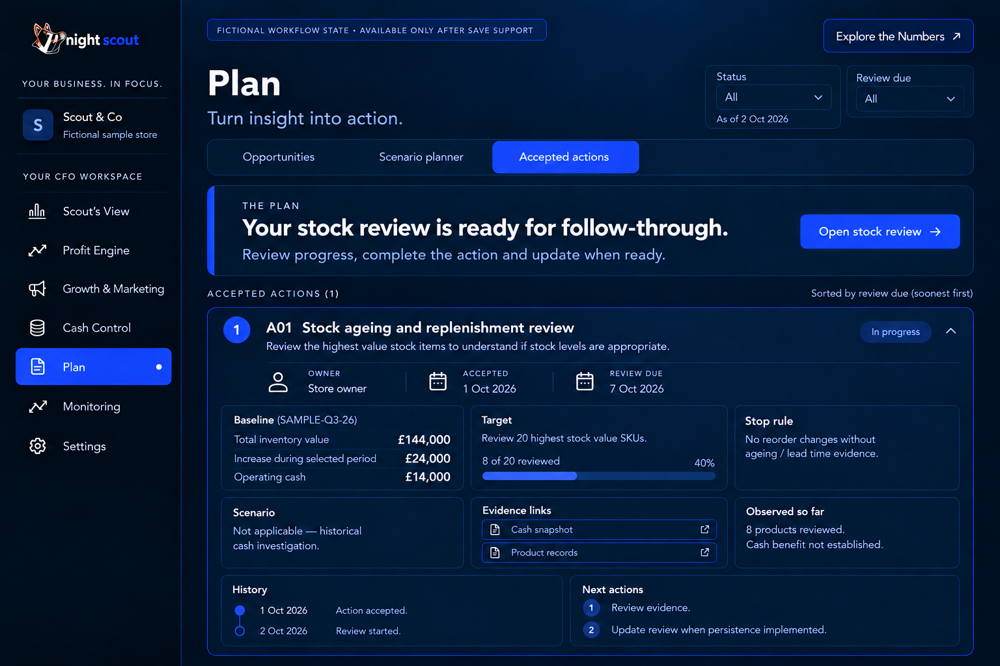
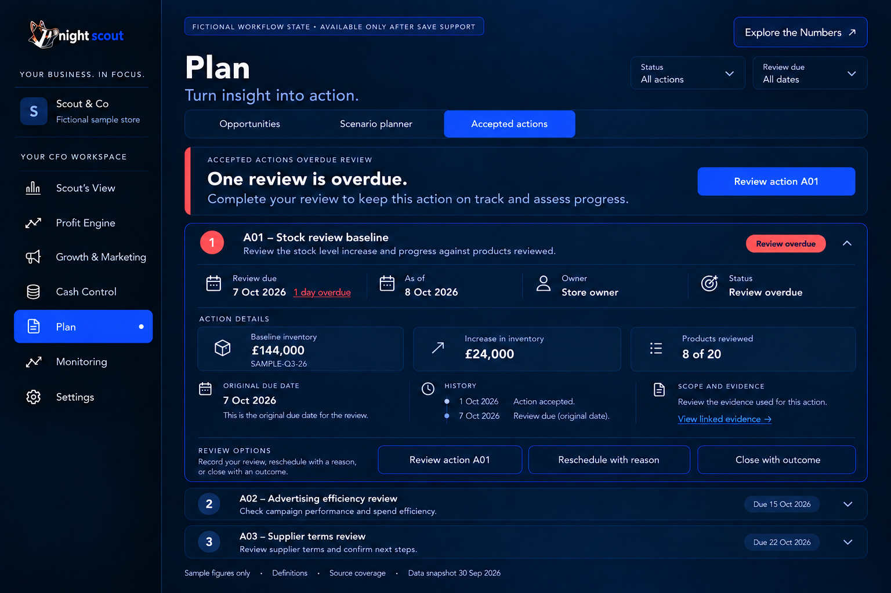

# 9 Plan Opportunities and Accepted Actions

## Opportunities

OP01 P1. The final sample prioritises Review stock movements because inventory is the largest evidenced working-capital movement and merits a low-effort investigation. It does not promise a recoverable £24,000 saving. The default opens that action and closes the discount and acquisition reviews. Expanded detail reveals evidence, trade-offs, owner, review date, success and stop criteria.

OP02 P0/P1. Stock opens Cash records. Define test assumptions opens a discount review with explicit order/AOV assumptions, adequate observation requirements, contribution and conversion guardrails. The acquisition action opens the Investment Scorecard. No stock action is passed into a P&L-only simulator as a cash model; no unsupported preset silently opens unrelated assumptions.

OP03 P0. Rank by supported impact, evidence, effort and time, with an inspectable reason. Do not sum overlapping opportunities. An owner and review date are required before acceptance. A fixed two-to-three-week test is not a universal sample-size rule. Savings and causal impact remain unestablished until the evidence supports them.

## Accepted Actions

AC01 P1. Provide empty, active and overdue-review states in the dedicated tab. Empty offers Review opportunities without invented KPI cards. Active shows action, owner, accepted date, baseline, target, progress evidence, review date, stop rule, scenario link where relevant and history. Overdue preserves the original date and asks for review or an explicit reschedule reason.

The fictional A01 example is a stock-ageing review accepted 1 October, owned by Store owner, due 7 October, with 8 of the 20 highest-stock-value SKUs reviewed. Its baseline is SAMPLE-Q3-26: inventory £144,000, increase £24,000 and operating cash £14,000. No scenario applies because this is a historical cash investigation. No reorder change is recommended without ageing and lead-time evidence. No cash benefit has been established.

The active screen is dated 2 October; the overdue screen is dated 8 October. These are alternative workflow examples, not current live events. Review evidence and progress remain separate from claimed financial results. Completed actions record observed outcomes and uncertainty rather than automatic causal savings.

AC02 P0. These workflow states require persistence and server-side permissions. Before that exists, show the capability as unavailable and retain read-only investigation. Once delivered, save/reopen reproduces the version, owner and review date. A refreshed baseline creates a new version; it does not rewrite history. Accepted reviews appear in Monitoring only when the actual service supports them.

## Acceptance

Every action opens a scoped relevant task. No monetary benefit is inferred from completion alone. Empty → accepted → reviewed/overdue → closed transitions preserve history, permissions and original dates. Rescheduling records a reason. No notification or financial operation is triggered merely by viewing a design.

[Back to the design index](README.md)

## Related mockups

These are illustrative designs with fictional data, not live screenshots.

### Plan Opportunities default

### Plan Opportunities expanded

### Accepted actions empty

### Accepted actions active

### Accepted actions overdue review

