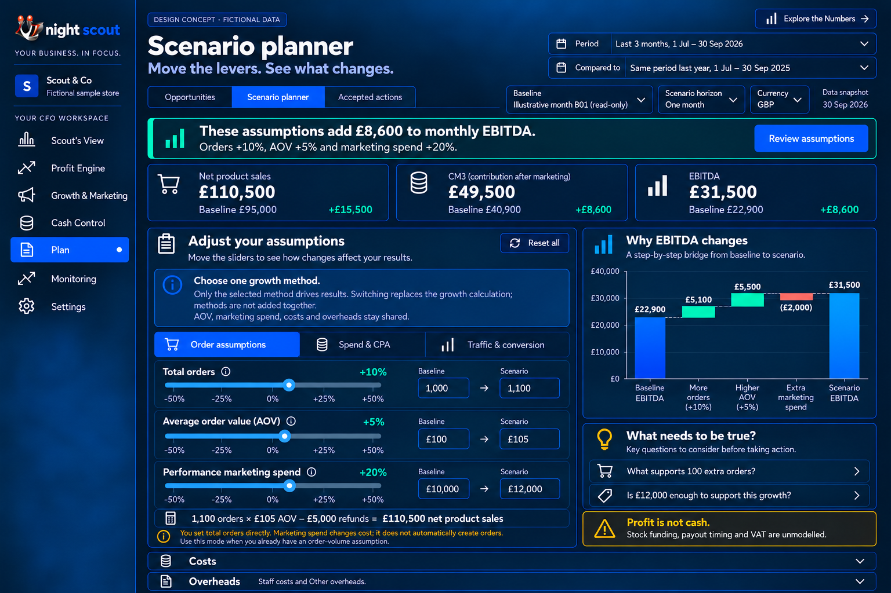
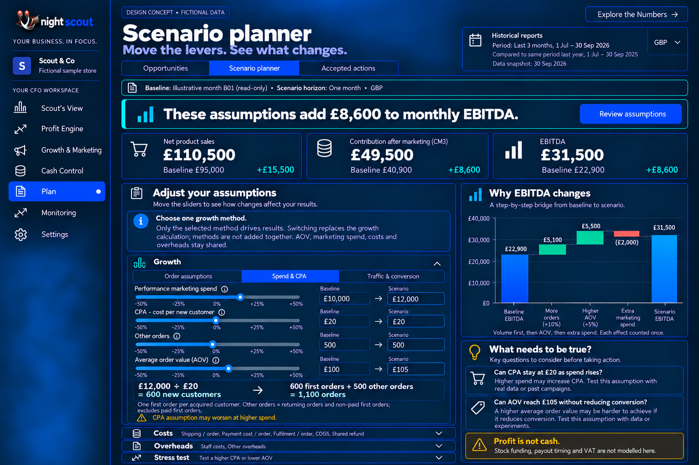
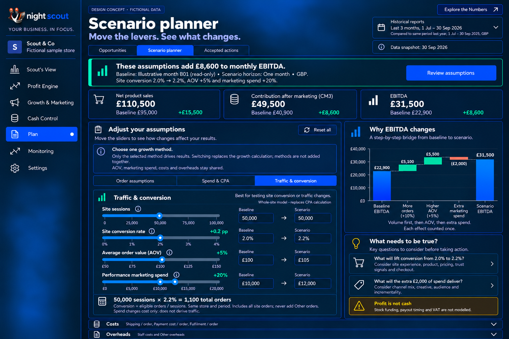
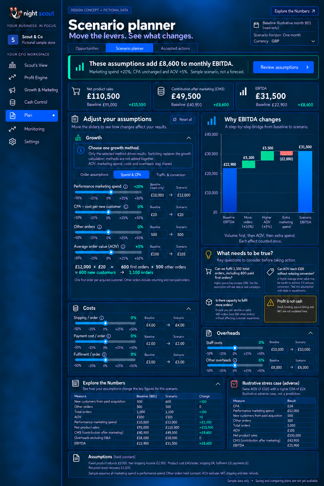

# 9A Scenario planner shared behaviour

SP01 P1. Keep the slider-based planner as Plan’s second tab. Show Baseline Illustrative month B01 read-only and Scenario horizon One month, GBP. Display net product sales, CM3 and EBITDA once with baseline and change. The headline is neutral: These assumptions add £8,600 to monthly EBITDA. It is not a recommendation to proceed. Review assumptions is the primary action.

## Guidance above every Growth selector

Choose one growth method. Only the selected method drives results. Switching replaces the growth calculation; methods are not added together. AOV, marketing spend, costs and overheads stay shared.

SP02 P0. One active method resolves orders. Remember inactive method-specific inputs but exclude them from all results. Common AOV, spend, costs and overheads persist and update across modes. Missing inputs produce Needs assumptions; never retain a stale result from another method. Show the active calculation and announce the changed result once.

SP03 P1. Order assumptions is the neutral first entry; a scoped acquisition link may select Spend & CPA. Baseline values are visibly non-editable; scenario values pair direct numeric inputs with sliders. Reset this method affects method-specific inputs; Reset all affects all scenario inputs. Neither changes the source baseline. Context changes require assumption revalidation.

SP04 P0/P1. Costs contains shipping, payment and fulfilment per order. Overheads contains Staff costs and Other overheads, with software folded into Other. Include fixed non-performance advertising separately in real businesses rather than silently dropping it. Deduct marketing and labour once. Costs, overheads and detailed evidence begin closed; the expanded reference reveals them without changing results.

SP05 P1. Place the EBITDA bridge beside the controls on wide screens, above the active controls on narrow screens without covering them. A What needs to be true panel names the uncertain assumptions. Keep Profit is not cash visible: stock funding, payout timing and VAT are not modelled.

## Assumption review and future persistence

Review assumptions checks CPA at the proposed spend, AOV/conversion, operational capacity and the absence of cash modelling. Save, compare and turn into action become available only after actual persistence exists. Saved records include active method, baseline ID, common and method inputs, formula/result version, owner and review date. No automatic ad or price changes occur.

A simple adverse CPA example may expand after the base case, not as more default sliders. Richer comparisons and channel-specific paid-traffic models remain later work. Do not add CPC, channel mix or paid/organic traffic controls to this first version.

[Back to the design index](README.md)

## Related mockups

These are illustrative designs with fictional data, not live screenshots.

### Plan Order assumptions

### Plan Spend and CPA

### Plan Traffic and conversion

### Plan Scenario planner expanded

