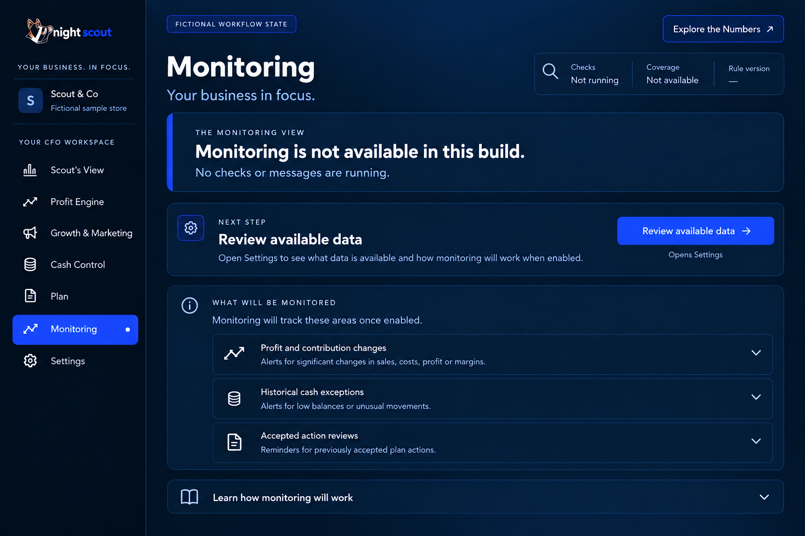
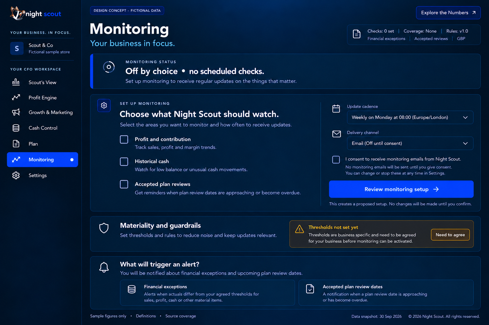
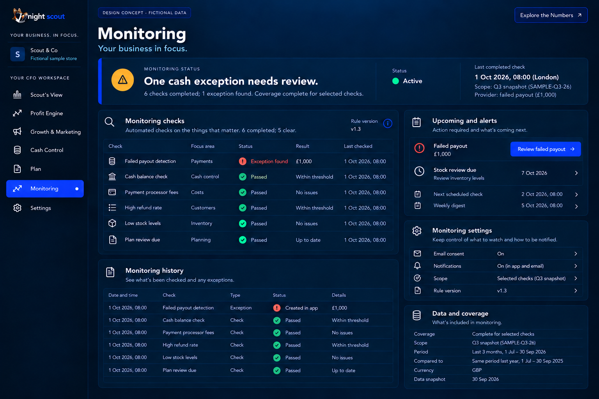
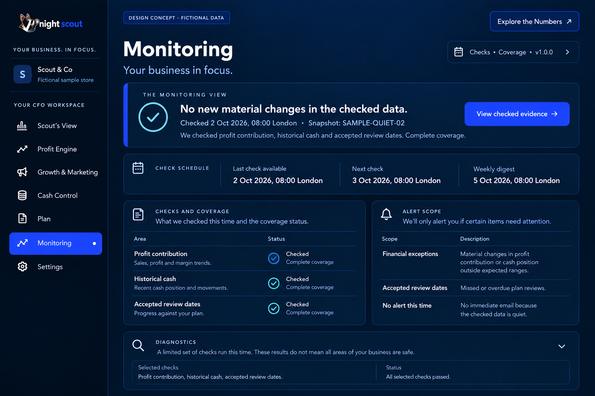
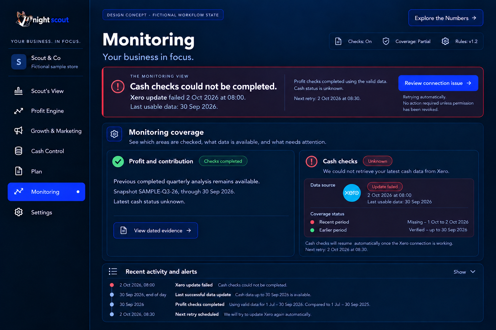
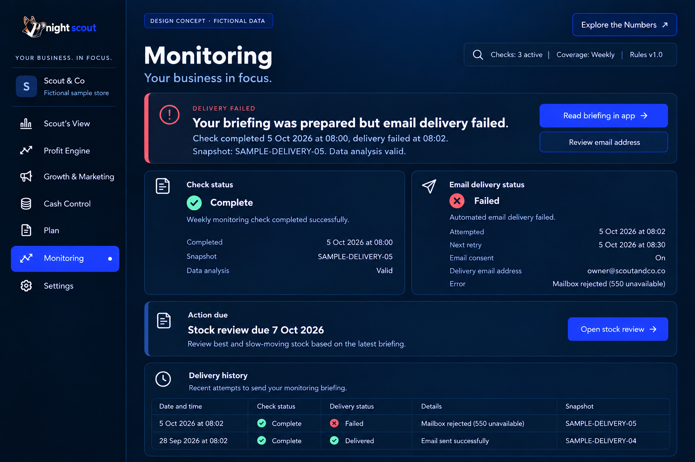

# 10 Monitoring states

MN01 P0. Distinguish service unavailable from a supported service the owner has not enabled. Show one concise status strip and the appropriate next step, without repeated inactive cards. Use check time, scope and next schedule; historical date filters belong only in check history. No runway or forecast promises are included.

| Reference state | Opening message and action | Required evidence |
| --- | --- | --- |
| Service unavailable | Monitoring is not available in this build. Review available data. | No checks or messages running; no enabled activation button. |
| Ready to set up | Choose what Night Scout should watch. Review monitoring setup. | Off by choice; scope, cadence, guardrails and unchecked consent. |
| Active actionable | One cash exception needs review. Review failed payout. | Completed 1 Oct 08:00 London; £1,000 failed payout; complete selected coverage. |
| Verified quiet | No new material changes in the checked data. View checked evidence. | Separate quiet fixture; completed 2 Oct 08:00; scope and next check visible. |
| Incomplete or failed data | Cash checks could not be completed. Review connection issue. | Xero update failed; last usable date 30 Sep; next retry; unaffected results retained. |
| Delivery failed | Briefing prepared but email delivery failed. Read briefing in app. | Check complete, delivery failed 5 Oct 08:02; retry 08:30; consent on. |

MN02 P1. Setup selects profit/contribution changes, historical cash exceptions and accepted review dates. Cadence, timezone, channel consent and business-specific thresholds are explicit. Review the configuration before activation. Saving, scheduling and delivery remain unavailable until implemented.

MN03 P0. A quiet state requires a completed scoped check and adequate data. Do not send an immediate “all clear” alert merely to prove activity. Distinguish unverified scope, stale sources, failed checks and failed delivery. A successful import is not sufficient financial coverage. A source fault cannot become quiet success.

MN04 P1. Actionable state shows one priority and a concise queue. History records check status, rule/snapshot version, delivery attempts and outcomes. A delivery failure preserves analysis and offers in-app access. Retry safely without duplicate messages; consent and permissions are enforced server-side.

The available-service screens are conditional workflow designs, explicitly labelled fictional. The actionable example uses SAMPLE-Q3-26 checked on 1 October; quiet, incomplete and delivery examples use separate state fixtures. They are not proof that the current service is active. The owner can inspect what was checked and when without having to interpret technical logs.

## Acceptance

No all-clear without a completed covered check; no notification without consent; no “saved” or “sent” claim before success. Service-unavailable, off-by-choice, failed data and failed delivery are visibly different. Review queues link to the right accepted action and version. Snooze and channel changes preserve an audit history.

[Back to the design index](README.md)

## Related mockups

These are illustrative designs with fictional data, not live screenshots.

### Monitoring service unavailable

### Monitoring ready to set up

### Monitoring active and actionable

### Monitoring verified quiet

### Monitoring incomplete data

### Monitoring delivery failed

