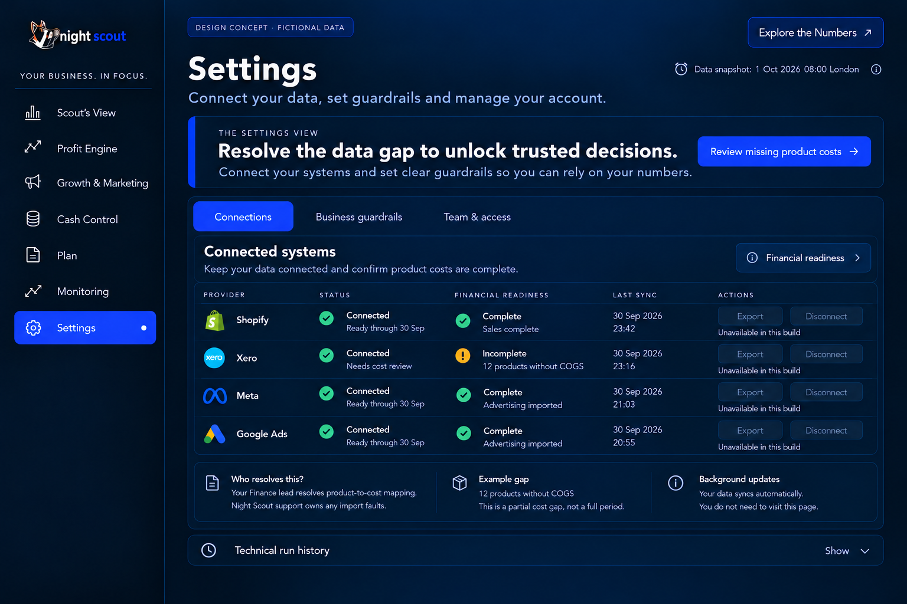
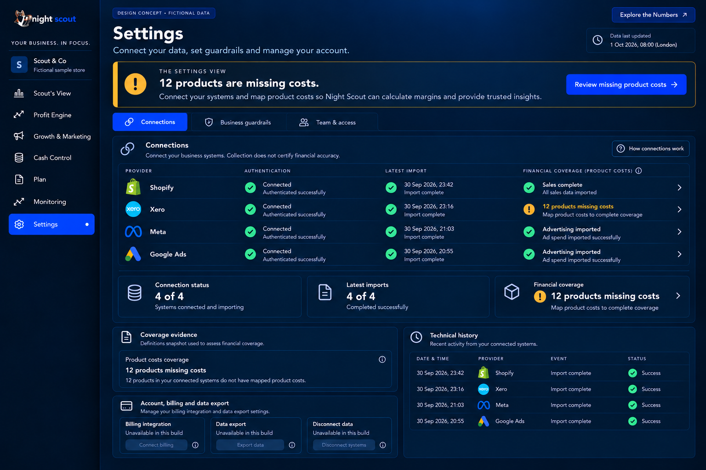
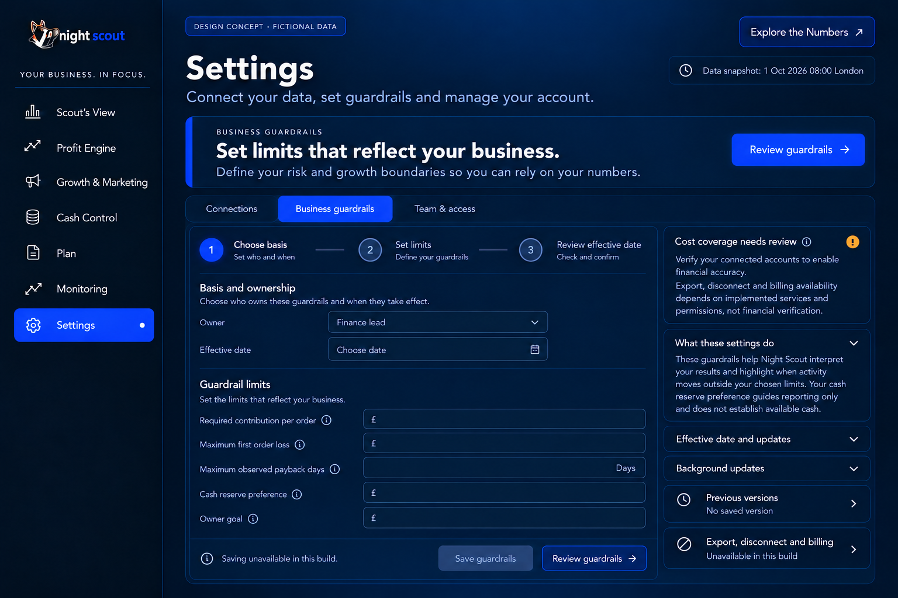
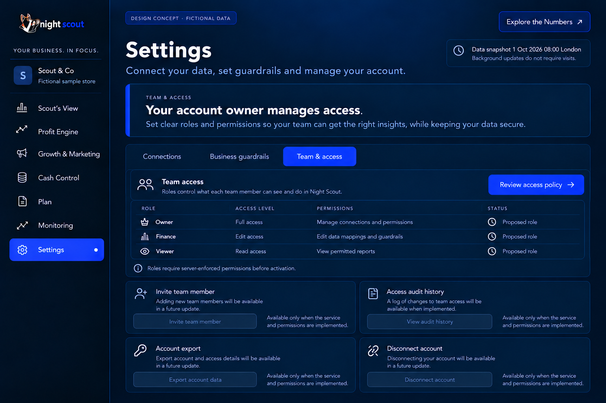

# 11 Settings subpages

## Connections

ST01 P1. Use owner-friendly Connected, Updating, Ready through [date] and Needs your attention states. Separate connection credentials, successful collection and financial readiness inside details. Show freshness, not a global historical selector. The default names a concrete recovery task; expanded view reveals coverage and technical history.

The example is an alternative incomplete fixture: 12 products lack mapped costs. Shopify, Meta and Google show data through 30 September; Xero is connected but cost review is needed. Review missing product costs leads to the affected products. Finance lead owns mapping; Night Scout support owns import faults. Unaffected sales remain available; complete profit advice does not.

ST02 P0. Background updates do not require owner visits. Do not imply that opening the app refreshes or validates data. Credentials alone never certify financial accuracy. Preserve last usable dated results. Export, disconnect and billing must be visibly unavailable until the real secured capabilities exist; do not draw enabled controls based on a conceptual design.

## Business guardrails

ST03 P1. A dedicated subpage guides Choose basis → Set limits → Review effective date. Inputs include required contribution, acceptable first-order loss, maximum observed payback, reserve preference and owner goal. The initial example has no universal numeric defaults. Explain the basis and consequences of each setting.

Review guardrails inspects the draft. Save requires persistence and authorised access. Record owner, rationale, effective date, previous value and history; retain past versions used by prior decisions. A chosen reserve preference is not evidence that cash is free to spend. Commitments and actual cash coverage remain separate.

## Team and access

ST04 P0/P1. The dedicated tab names the current account owner’s responsibilities and the supported policy. Planned roles are Owner, Finance and Viewer, with explicit permissions. Do not invent personal identities or email addresses in the example. Invitations remain unavailable until invitation delivery and server-side permissions exist.

Owner manages access and connections; Finance can edit authorised cost mappings and guardrails; Viewer reads permitted evidence. Final permission implementation must enforce business isolation, protect historical decision versions and record changes. Review access policy is a read-only next step in the unsupported state.

## Acceptance

The owner identifies the exact task they can resolve or sees that no action is required. Import retries do not become user obligations. Settings tabs retain the same navigation and Explore the Numbers link. Drafts do not look saved; disabled capabilities explain why. Updates, access changes and effective-dated guardrails are tested with appropriate roles.

[Back to the design index](README.md)

## Related mockups

These are illustrative designs with fictional data, not live screenshots.

### Settings Connections default

### Settings Connections expanded

### Settings Business guardrails

### Settings Team and access

