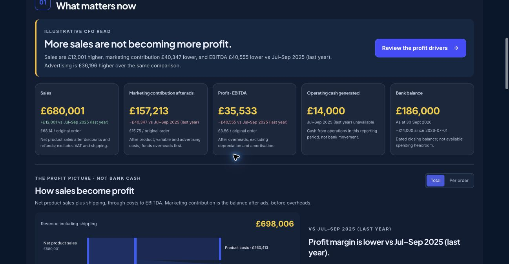
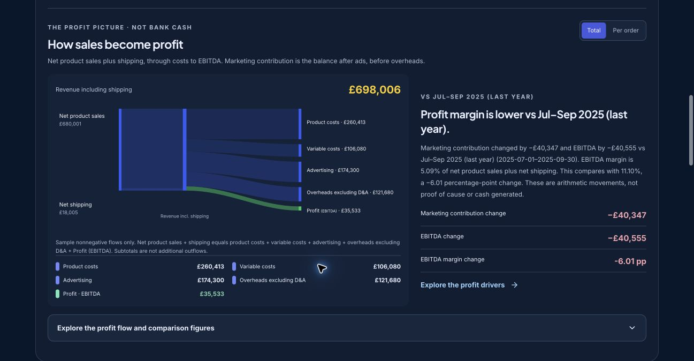

# Scout’s View — approved rewrite implementation, 21 November 2026

Status: implemented and locally reviewed; **not deployed**. Paul approved the proposed insight-first rewrite and explicitly added marketing contribution alongside EBITDA. This supersedes the v11 four-outcome layout and the earlier proposal-only/first-use opt-in design. It does not enrol anyone in monitoring or create a saved preference/action.

## Source and ownership
Isolated branch: codex/scout-design-20261121. Base includes shared cleanup 4ab7b6fcec1a5cdb5be9bb09f48ea042e1755177 and data-lane e1ed8962cc55b8093c802afe5ef0c4f31b8c2cd4. No Marketing, Profit, Cash, Plan, server, provider, role or schema implementation is replaced. PM owns the combined website release and operational roadmap.

Scout-only code: pages/scouts-view.tsx/.css, lib/scout/overview-model.ts, lib/scout/profit-flow.ts and their focused tests. Proposed shared integration: App.tsx mounts Scout at /dashboard with /scouts-view alias and preserves the previous CFO Briefing at /cfo-briefing-original; Sidebar changes only the /dashboard label to Scout’s View. These route/menu diffs are flagged for PM coordination.

## Owner experience
1. A compact header with persistent Explore the Numbers, exact historical period and named comparison.
2. One business verdict and primary action, then **five** outcomes in order: Sales, Marketing contribution after ads, EBITDA, Operating cash generated, Bank balance.
3. At most three supported explanations, each with a finding, implication, purposeful signed-value visual and specific specialist link.
4. One practical next step from the ranked finding; Plan is a separate conditional model, with no invented forecast or savings.
5. Closed source tables reproduce outcomes, each reference basis, financial revisions and independently accepted cash/customer snapshot IDs and observation times.

Month/version controls remain open until evidence can be chosen, then collapse behind Change period or comparison. Exact scope remains visible. Five cards fit readable desktop layouts; mobile becomes one column. Cash and bank are always totals; subordinate per-order figures are shown only for the three financial outcomes with their matching original orders.

## Owner-approved profit-flow addition
Paul approved the layout via PM and requested a compact Sankey with prior-period commentary. The layout is retained with this visual after the five outcomes, inside section 01; final owner acceptance and coordinated release remain pending.

The visual reuses Profit Engine’s exported renderer and reconciled flow guard. Revenue is net product sales plus net shipping. Cost outflows are product costs, variable operating costs, advertising and overheads excluding D&A, with EBITDA as final profit. Marketing contribution is an intermediate subtotal, never an additional outflow. Bank/cash balances never enter this profit flow.

A strictly earlier, independently selected and verified source version is required for comparisons, matching company, currency, timezone, edition, anchor and formula. Commentary names its dates and reports absolute contribution/EBITDA changes plus EBITDA margin percentage points. Total/per-order controls use each period’s own original-order denominator; margin remains a ratio of total EBITDA to revenue including shipping. Variance is not causal proof. Missing comparison preserves current evidence with an explicit comparison-unavailable state.

Losses, negative source amounts, zero revenue, missing or inconsistent evidence never become positive ribbons. Signed supported figures use the accessible table alternative; missing figures stay unavailable. Source/version/formula and exact financial tables sit in Explore the profit flow and comparison figures. Mobile stacks commentary under the visual, supplies a readable HTML legend, and confines any table overflow to the disclosure.

Independent review and 11 focused flow tests cover reconciliation, contribution nonduplication, shipping-inclusive margins, own-order denominators, source/version matching, loss/negative/zero/missing states, nonpositive prior percentage guards and unsafe numeric boundaries. Desktop and 390px sample preview are separate from real connected-data acceptance.

## Outcome/source register
| Outcome | Source | Definition and guard |
| --- | --- | --- |
| Sales | Reviewed month amounts.netProductSales | Net product sales after discounts/refunds, excluding VAT/shipping. |
| Marketing contribution after ads | Existing linkedMarketingMetrics(month).contribution | Gross profit + net shipping − variable operating costs − advertising. Before overheads; not added to EBITDA as another benefit. |
| EBITDA | Existing matched reviewed financial amounts | Contribution after ads − overheads excluding D&A. Reconciliation conflicts withhold dependent totals. |
| Operating cash | Accepted cash supplement cash.operatingCash | Separate selected-period flow after the cash/financial matching and working-capital reconciliation guards. |
| Bank balance | Accepted cash supplement cash.closingBankCash | Closing balance as at scope.to. Reference is current opening bank, not an unrelated prior-year amount. No spending-headroom inference. |

Cash/customer data is accepted through useReviewedSupplement, reviewedSupplement, cashSupplementView and acquisitionView, with exact company, month, version and source revision checks. Existing restricted APIs are reused; no new read access or SQL is proposed.

## Insight policy
Deterministic decisions precede prose. The priority order is inspectable: contribution shortfall/supported loss, positive profit consuming operating cash, deteriorating contribution/profit, then supported acquisition/customer findings. The order is a prioritisation policy, not a confidence percentage, estimated savings score or universal scaling rule. Stock is a possible signed cash driver, never a permanent stock-first alert.

A CAC concern requires matched first-order contribution, not CAC alone. Visits use purchasing sessions rather than order counts. Repeat orders are not unique customers; repeat sales rising while first orders fall is not automatically improved retention. Current-period sales value is not LTV. No future new-cohort repeat demand is inferred.

Unknown, failed, loading or invalidated evidence is not zero. Independent financial results remain visible while supplemental sources are unavailable. A neutral result does not claim completed monitoring or an all-clear. Example mode is a deliberate user choice, using the agreed v11 financial/cash fixture; missing real sources never trigger it.

## Specialist handoff — truthful current limitation
Links identify the exact specialist/tab and carry reviewStore, reviewFrom, reviewTo and reviewVersion as source context. Profit links additionally carry the previous comparison request where present. Plan receives no implied verified scenario.

**Automatic application of those query parameters by specialist selectors remains a shared integration task.** Current UI says to confirm the same reviewed month on the detail page. PM/data lane should coordinate the optional current/comparison reader-role change rather than Scout silently modifying another lane’s pages. Preserve authenticated store binding, available-month/version validation and independent comparison selection; a query string must never grant access or select withdrawn evidence.

## Requirement trace
- SV01: one supported verdict and primary action; approved five-outcome exception.
- SV02–03: explanation and next moves use specialist results; no fixed stock priority or duplicated full dashboards.
- SH01–05: purpose/context, persistent evidence, explicit unavailable/sample states, neutral incomplete state, readable labelled mobile controls and details.
- DT03–04: current/comparison figures, narratives and evidence derive from accepted monthly scopes; no fabricated finer buckets.
- UN01–02: financial per-order figures use each outcome’s original orders; cash/bank are not divided by orders.

## Verification and release boundary
- 23 meaningful Scout model tests pass (12 overview + 11 profit-flow). Overview coverage: five outcomes, contribution/profit pressure, loss, ranking, matched cash arithmetic, cross-business/overlap suppression, incomplete sources, acquisition prerequisites, session/customer distinctions and denominator guards.
- TypeScript library build, API typecheck and frontend typecheck pass after linking the worktree’s existing dependencies.
- Isolated esbuild UI preview passes. Desktop review confirms the verdict/action and five measures; real 390px iframe review confirms five outcomes, no document overflow, accessible details and a visible primary action.
- Local production Vite bundling is blocked by the existing Mac runtime/unsigned native Rollup Team-ID restriction. No signing/security protection was changed. No lockfile/dependency source changes are included. The combined production build remains a release gate in the shared working build environment.
- No shared staging deployment, live source/data write, provider operation, access change, scheduler change, production release or spending occurred.

## Visual review
The screenshots below are explicitly fictional design examples, not live merchant evidence.

## PM integration checklist
1. Preserve the e1ed8962 data/Plan batch and cleanup when combining this Scout commit.
2. Review the two small shared route/menu diffs; do not remove other specialist or legacy pages.
3. Coordinate the shared reader handoff so current and comparison scopes apply to the right selector instances.
4. Run one final combined root build and applicable tests in the working release environment.
5. Sequence one staging deployment, then signed-in same-scope checks against financial and supplemental October figures; source-only preview is not that acceptance.
