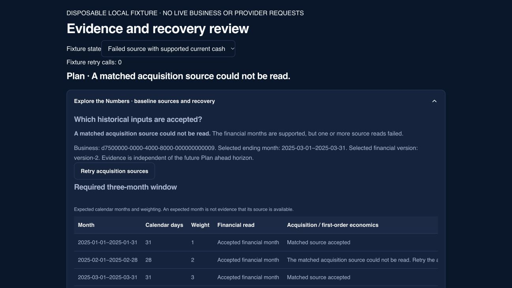
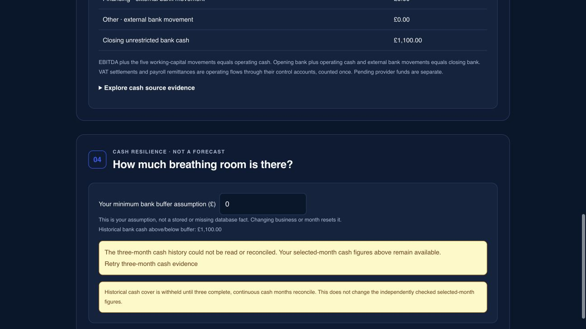

# Plan and Cash evidence recovery — next source-only package

Isolated branch codex/evidence-recovery-20261121 starts at published support patch **f2b811961ae1b5c9fc25fe8e56d8edb58678b22b**, preserving coordinated3eda388, navc6e72ca, owner-finishedScout5dd18ef, data/cleanup and all reference routes/source/data. The exact approved website **3eda388d534b820728172e0edb7ab9b51d0cc3ad** remains a separate release owned solely by the data lane. This package is for a later separately pinned review; it must not amend that approved deployment.

## Bounded deliverables
- Plan: distinguish no selection, checking, insufficient financial coverage, failed financial check, failed/rejected acquisition evidence and unsupported economics; keep Explore the Numbers available in unavailable states. Show existing three constituent months, weighting, financial versions/revisions and accepted acquisition/economics lineage, plus actual accepted source inputs where available. Do not reverse-engineer source months from a blended baseline or change financial formulas, scenarios, drafts or repeat forecasting guards.
- Cash: expose independent financial-window and supplemental-window status/retry; distinguish absent coverage from failed read/reconciliation, with no partial-window totals or stale fallback. Keep independently accepted current cash visible. Request only the three financial months needed for resilience so unrelated earlier-month failure cannot veto them. This is historical arithmetic, not a forecast/spending permission.
- Independent truthfulness and local browser review: missing/stale/error states, exact evidence/denominators, source hashes, keyboard/mobile disclosure and retry behaviours. No merchant/provider requests in fixtures.

## Ownership
Plan worker owns useReviewedPlanBaseline, Plan visual/evidence components and focused tests. Cash worker owns useReviewedCash, CashSourceFigures and additive failure metadata in useReviewedHistorySeries, plus focused tests. The shared series addition must not change selection/query eligibility/accepted financial output for existing consumers; shared selector useReviewedHistory and nav remain frozen. Reviewer is read-only. Coordinator owns integration, local fixture preview and this scoped record.

Xero staging-company binding belongs to the integration lane: see ../handoffs/xero-staging-company-binding-2026-11-21.md. No provider/server/auth/bootstrap implementation is made in this batch.

## Release boundary
No live read/write, provider operation, database/schema/data/grant, feed/job, settings/config, service/deploy or spending change. No hosted browser tab is used; data owns hosted acceptance. Missing evidence is never zero, sample or an assumed complete plan. Old reference pages and bookmarks remain.

Exact changed files, tests, browser evidence and final separate source SHA are recorded in the completion section after integration. Existing unaffected core/nav/Scout tests are not repeatedly rerun.

## Completed integration and verification
Plan now always exposes source recovery and Explore the Numbers, including unavailable/loading states. Status distinguishes selection, financial read versus coverage/cost completeness, acquisition transport versus absent/unsupported proof, and rejected combined economics. Each accepted source month shows actual amounts (stored pence converted to pounds once), orders, paid-first populations, days/weights, exact financial revisions and acquisition envelope/source bindings. Missing acquisition cells stay unavailable. Independent prior-year history failure has its own retry and does not veto a supported starting baseline. No weighted baseline/projection/draft formula or binding model changed.

Cash now requests a dedicated three-month financial window, with additive failure/retry metadata from the existing series reader (no selector or accepted-series behaviour change). Independent current cash remains visible where accepted; three-month results are atomic and withheld on missing/failed/aborted/refetch states. The window key binds current cash snapshot/observation/source/mapping identity; a selected-month identity mismatch is rejected and retry rechecks both current and window. Ordinary window read failures retry only the relevant window. Missing current cash does not produce a claim that current figures remain available.

- **18/18 focused recovery tests pass**:8Plan status/calendar cases,3actual Plan-hook orchestration cases,4atomic Cash reader cases and3actual Cash-hook cases. Hook tests substitute readers/query adapters and exercise source orchestration; existing baseline/formula validation is not claimed from those stubs. Worker also checked4existing reviewed-baseline guard tests. Do not sum old unaffected46suites into this batch.
- **Full root pnpm run build passes** on the final source: referenced libraries, all4workspace typechecks, API bundle and both frontend production builds. Existing sourcemap/mixed-import/chunk-size warnings remain nonfatal. No dependencies or lockfile were changed.
- Independent read-only source review passed: no partial/sample baseline, no mixed current/window cash revision, no false missing-versus-failed claim, current/prior/forecast scopes separate, exact source identity and units preserved.
- Isolated local browser review rendered real PlanBaselineEvidence and CashSourceFigures/Resilience with explicitly disposable synthetic inputs. Accepted three-month sources, a failed middle acquisition source, unavailable current cash, missing earlier coverage and separate retry callbacks were inspected. Both Plan and Cash retry buttons dispatched their own fixture callbacks. Exact versions/revisions and missing acquisition cells were visible; no provider or merchant call occurred.
- A390px iframe measured document clientWidth=scrollWidth=390 with disclosures expanded. Wide tables stay in named focusable scroll regions; keyboard ArrowRight moved the accepted-input region to scrollLeft40 with focus retained. These checks validate presentation/recovery affordances, not live hooks/providers or authenticated hosted acceptance. The actual hook orchestration is covered by the focused tests above.
- The local browser harness uses the existing coordinated CSS and exact current source components; full production CSS/bundles separately passed. Local review scaffold is excluded from commits. No hosted browser tab was used or modified.

## Next exact release review
The published source SHA/tree supplied with this package identifies a **new, separately reviewable candidate**, including pending support patchf2b8119 plus these Plan/Cash fixes. It is not an amendment to owner-approved3eda388 and must not be deployed under that exact approval. Data remains sole deployment/hosted-acceptance owner. Reconcile any newly published source/live-head changes before proposing a later exact website release. No database, provider, feed, service/config or spending scope is included.

Source diff confirms accepted Scout pages/model/styles, shared selector useReviewedHistory/reviewHandoff, App/routes/navigation, baseline-builder/projection/draft-binding models and prior reference source are unchanged. Xero company binding is a handover only. No new owner input was required for this source package.
