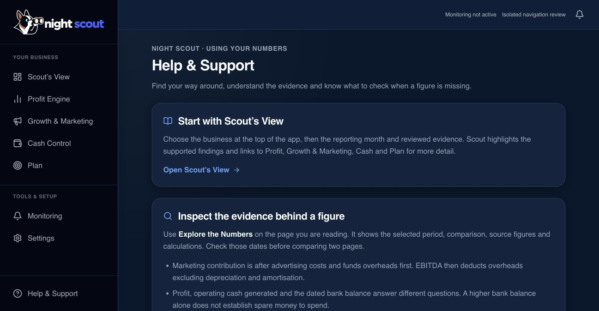
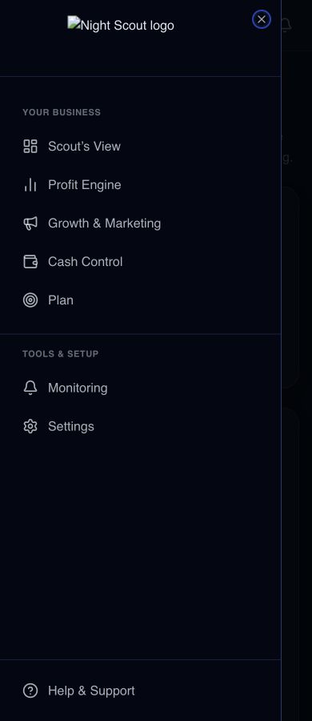

# Five-core navigation — inventory and reversible consolidation

Status: source preparation; not deployed. Scout v17 is visually/design accepted at exact 5dd18ef. Its page/model/styles are frozen. This batch changes shared navigation, valid URL handoff and support routing separately.

## Inspected inventory
The accepted source has nine desktop entries: Scout’s View, Growth Quality, Marketing Efficiency, New Marketing, New Profit Engine, New Cash Control, New Plan, Monitoring and Settings. Header also advertises the v11 reference preview. Footer Help links to an undeclared route. The normal mobile hamburger has no behaviour while Sidebar is hidden below md. These are source-inspected observations; the current shared hosted revision must be rechecked before release.

## Proposed owner-facing menu
Five core areas: Scout’s View (/dashboard), Profit Engine (/profit-engine), Growth & Marketing (/new-marketing), Cash Control (/new-cash-control), Plan (/plan). Support: Monitoring (/monitoring), Settings (/settings), Help & Support (/help). Keep existing canonical URLs to avoid an unnecessary URL migration; remove temporary New labels only. Desktop and accessible mobile navigation share one inventory.

## Exact retirement map for review
| Existing page/URL | Proposed treatment | Bookmark/context consequence |
| --- | --- | --- |
| /dashboard | Keep approved Scout v17 | Exact reviewed source links remain contextual. |
| /scouts-view | Keep alias to /dashboard | Preserve reporting query/hash. |
| /profit-engine | Keep Profit Engine | Selected current and comparison evidence must validate independently. |
| /new-marketing | Keep Growth & Marketing | Keep acquisition/conversion/retention tab and selected month. |
| /new-cash-control | Keep Cash Control | Keep selected month; cash evidence has independent acceptance. |
| /plan | Keep combined Plan | Baseline and assumptions remain independently selected; no one-month Scout baseline substitution. |
| /growth-quality | Retire from normal menu; preserve reference URL pending review | Do not redirect before useful diagnostics and source meaning have been assessed. |
| /marketing-efficiency | Retire from normal menu; preserve reference URL pending review | Prior marketing design remains available for comparison. |
| /marketing-efficiency-original | Preserve reference, no main menu | No source/data deletion. |
| /cash-control | Preserve original reference, no main menu | Do not silently exchange old sample/history semantics for connected Cash. |
| /cfo-briefing-original | Preserve original reference, no main menu | Old CFO Briefing remains separately accessible. |
| /opportunity-finder-original | Preserve original reference, no main menu | Useful planner controls remain reviewable. |
| /scenario-planner-original | Preserve original reference, no main menu | No automatic migration of scenario assumptions. |
| /margin-analysis, /pricing-optimisation, /new-profit | Keep existing Profit redirects | Preserve validated reporting context and section hash. |
| /opportunities, /profit-opportunities | Keep existing Plan opportunities redirects | Destination tab wins; no automatic approved scenario. |
| /scenario-lab | Keep Plan planner redirect with legacy=1 | Explicit legacy marker retained; no assumptions silently reinterpreted. |
| /monitoring, /cfo-alerts | Keep support destination / existing alias behaviour | Service availability remains truthful. |
| /settings, /financial-review | Keep settings and exception workflow | Auth/access checks unchanged. |
| /dashboard/transactions | Preserve old route pending exact retirement review; do not advertise | Currently old briefing, not transactions/evidence; cannot promise ledger detail. |
| /v11 and /v11/:section | Preserve design reference URLs; remove global preview promotion | Fictional reference does not become merchant evidence. |
| /supported-v11/history, /supported-v11/scout, /supported-v11/profit | Preserve protected evidence/reference routes | Not extra core destinations; existing access guards unchanged. |
| /verified-sales | Preserve development-only route | Never advertise as production evidence workflow. |
| /help | Add truthful guidance route | No fake support chat, ticket delivery or monitoring service. |
| /, /login, /signup, /upgrade, /xero/callback | Preserve public/account/integration routes | No auth, billing or provider callback change. |

No source files, stored data, summaries, API routes, credentials, grants or provider connections are deleted. The retirement proposal removes duplicate main-menu choices only; permanent page deletion and new redirects for legacy references await this exact list’s review. Reversal consists of restoring menu entries; old URLs/source remain.

## Shared selector handoff
Scout reporting URLs carry company, current period/version and (for Profit) independent earlier comparison. Receiving selectors must validate against the authenticated active business, server-available exact month and selected evidence version. A query never grants access. Manual selections override the one-shot handoff. Plan does not inherit a historical month as an approved three-month baseline. A receiving-page source choice is distinct from live connected-data acceptance.

## Release boundary
This batch preserves 5dd18ef, its e1ed8962 data/Plan ancestry and cleanup 4ab7b6f. Latest additive customer-contract source c118969 is integrated separately without activating new summaries. No concurrent staging deployment is authorised by this source preparation. PM coordinates one exact website revision, combined build/test receipt, target/config readback and subsequent signed-in acceptance. No database/provider/feed/spend action is included.

## Verification receipt
- Live read-only browser audit on 21 November still shows CFO Briefing, nine desktop menu items, the reference-preview promotion and Help link. No staged Scout acceptance is claimed.
- **43/43 focused tests passed**: 23 frozen Scout model/flow tests plus 10 selector-handoff and 10 route/navigation tests. No skips/failures.
- **Full root `pnpm run build` passed**: referenced-library build, all four workspace typechecks, API bundle, mockup frontend and app production frontend. Used checksum-verified official Node24.11.1 and temporary pnpm10.11.0 with existing frozen-lockfile dependencies; no dependency install, lockfile change or security bypass. Existing tooltip/sheet sourcemap, mixed Supabase import and large-chunk warnings remain nonfatal.
- Native 390px browser review: labelled navigation drawer opens; shared five core + three support links are present; Escape closes and returns focus to Open navigation; selecting Help closes it; document width and scroll width both390. Desktop shows the same destinations. The review stubs only monitoring/plan header indicators; it does not validate those services.
- Disposable local browser verification uses the actual receiving hook with a fictional auth/session and synthetic HTTP responses. A link seeds current March2025/version2 and comparison February2025/version1 exactly; a manual January/version0 selection wins; a withdrawn version remains unselected with a visible recovery message. No live merchant/provider request or database write occurs. This verifies implementation, not real connected-data acceptance.
- Scout source/model/styles are byte-identical to accepted5dd18ef. Specialist changes are limited to explicit hook-role opt-ins (Profit current+comparison, Cash current, Marketing current; Marketing comparison and Plan baseline stay independent).
- Bookmarks retain reporting context. Manual overrides last for the mounted receiving workspace; reloading/remounting deliberately revalidates the original URL. User/company changes cancel the candidate in a persistent hook; a new authenticated mount always rechecks active company and exact selected version.

